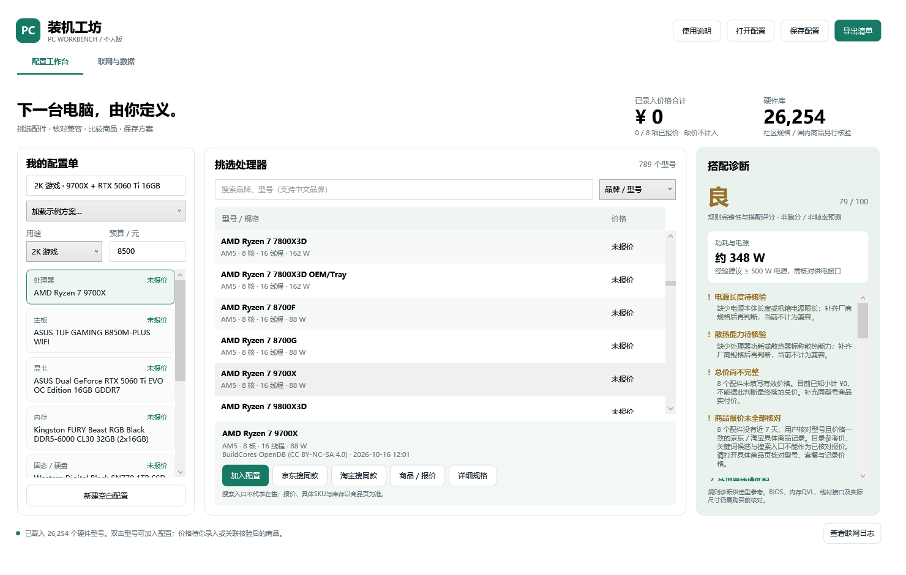

# 装机工坊 · PC Workbench

供个人使用的 Windows 装机配置工具。选择配件、录入或核对报价，即时查看兼容性与“优秀／良／差”搭配评级，以及具体原因和改进建议。

**[下载 Windows 软件包](https://github.com/peacecdt/pc-diy/releases/download/v1.0.0/PCWorkbench-1.0.0-win-x64.zip)** · [全部版本与附件](https://github.com/peacecdt/pc-diy/releases) · [使用说明](docs/USAGE.zh-CN.md)

Windows 10 / 11，64 位。解压后双击“装机工坊.exe”运行，无需另装 .NET、Python 或 Node。EXE 内置运行时和离线硬件库。



## 功能

- 内置 **26,254** 个社区硬件型号：CPU、主板、显卡、内存、存储、散热、电源、机箱；支持中文品牌关键词和型号搜索。
- 4 套可修改示例：核显办公、1080p 游戏、2K 游戏、创作。
- 即时检查插槽、DDR、条数与容量、机箱尺寸、电源、散热、存储接口及预算；未知关键参数不会被视为已经兼容。
- 提供“优秀／良／差”评级；缺件显示“待完善”，每项判断附原因。规则评分不是性能跑分或帧率预测。
- 保存／打开配置、自动保存、导出可打印 HTML 和文本采购清单。
- 自动联网同步硬件库；京东／淘宝搜索、官方接口商品查询、手动报价与商品链接记录。

## 联网范围

硬件库来自 [BuildCores OpenDB](https://github.com/buildcores/buildcores-open-db)，不需要 API 密钥。首次同步约 45 MB，需要能够连接 GitHub；更新失败时继续使用内置库或缓存。自动任务仅在软件运行期间执行。

京东／淘宝自动商品查询需要**你自己的官方应用密钥及对应接口权限**，在软件“联网与数据”页填写。未配置时可使用浏览器搜索入口和手动报价。凭据以 Windows DPAPI 加密保存，不会写入配置导出文件。

**内置型号不保证国内全部在售。** 社区库不提供国内价格和库存；所有初始报价为空。接口返回的是关键词候选，必须核对具体 SKU、套餐与卖家后才能采用报价。真实账号授权成功后的商品报价尚未实测。完整范围和限制见[使用说明](docs/USAGE.zh-CN.md)。

## 从源码构建

在 Windows 安装 [.NET 8 SDK](https://dotnet.microsoft.com/download/dotnet/8.0)，于仓库根目录执行：

```powershell
.\PcWorkbench\publish.ps1
```

输出目录为 `PcWorkbench/dist/`，生成自包含的 Windows x64 单文件 EXE。硬件 JSON 作为资源嵌入，数据归属和许可证随包保留。

运行测试：

```powershell
dotnet run --project PcWorkbench/tests/RatingEngine.Tests.csproj -c Release
dotnet run --project network_probe/NetworkProbe.csproj -c Release
# 可选：真实硬件下载及缓存复用测试
dotnet run --project network_probe/NetworkProbe.csproj -c Release -- --live
```

[验证记录](docs/VALIDATION.md)包含测试范围与未验证事项。无需提供真实商品 API 凭据即可运行离线测试。

## 仓库结构

```text
PcWorkbench/          WPF 软件源码、内置数据、构建脚本
PcWorkbench/tests/    兼容性与评级测试
network_probe/       联网映射、签名与商品响应测试
docs/                使用说明、验证记录和界面预览
```

可运行软件、完整便携包、源码压缩包及 SHA-256 校验值位于 [Releases](https://github.com/peacecdt/pc-diy/releases)。开发环境、构建缓存、用户配置及联网密钥不纳入仓库。

## 数据归属与使用范围

硬件数据由 **BuildCores OpenDB** 提供，转换后的数据库和示例摘选遵循 **CC BY-NC-SA 4.0**，供个人非商业使用。请保留归属、许可及修改说明。详细内容：

- [数据库来源及转换说明](PcWorkbench/Data/NOTICE.txt)
- [数据库完整许可证](PcWorkbench/Data/LICENSE-OpenDB.txt)

数据库许可不应被理解为对整个应用源码另行授予相同许可证。
